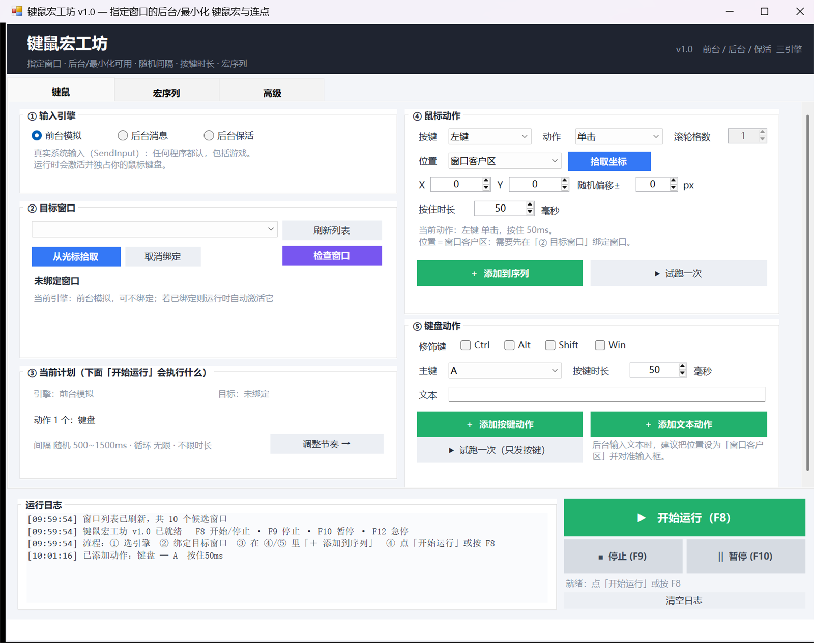

# 键鼠宏工坊 v1.0

指定窗口的键鼠宏 / 连点工具。**不抢前台、目标最小化也能跑**，可调键位、随机间隔、按键时长，支持多步宏序列。
免安装单文件 exe，无第三方依赖、不联网。



---

## 1. 快速开始

只有**一个执行对象：动作序列**。三个步骤走完就能跑。

1. 双击 `dist\键鼠宏工坊.exe`
2. **① 输入引擎**：选哪种方式去操作目标（见下表）
3. **② 目标窗口**：点「刷新列表」选窗口，或点「从光标拾取」（3 秒倒计时，把鼠标移到目标窗口上）
4. **④ 鼠标动作 / ⑤ 键盘动作**：设好键位、位置、时长，点「＋ 添加到序列」
5. 看 **③ 当前计划** 确认要执行什么 → 点底部「▶ 开始运行 (F8)」

> **「▶ 试跑一次」是显式的一次性动作**：只发这一次，不加入序列、不遵守序列的循环设置。
> 主按钮什么时候能按、不能按的原因，直接写在按钮下方；能用/不能用都会立刻反映在界面上，不需要点一下才知道。

### 界面不骗人（本次重做的一点）

- 只有**一个**开始入口，删掉了"运行鼠标动作 / 运行键盘动作 / 开始"三处并列
- 参数用不到时**置灰**并说明原因：动作不是滚轮 → 滚轮格数置灰；位置＝当前光标 → X/Y、随机偏移、拾取坐标置灰；动作是按下不松/抬起 → 按住时长置灰
- 引擎需要窗口但没绑定时，② 卡片直接出红字警示，主按钮同步变灰
- 禁用状态的按钮**连颜色一起变灰**，不会出现"绿色但点不动"
- 「③ 当前计划」实时显示：引擎、目标、动作数量与顺序、间隔/循环/上限

---

## 2. 三种输入引擎（核心）

| 引擎 | 动作原理 | 前台 | 后台 | 最小化 | 适用 |
|---|---|---|---|---|---|
| **前台模拟** | `SendInput` 真实系统输入 | ✅ | 需先激活 | ❌ | 游戏、反作弊客户端、一切程序 |
| **后台消息** | `PostMessage` 投递给目标窗口 | 不影响 | ✅ | 多数 ✅ | 标准 Win32/WinForms、部分浏览器、模拟器 |
| **后台保活** | 把窗口移出屏幕（不真最小化）+ 后台消息 | 不影响 | ✅ | ✅ | 最小化会冻结的程序、Chromium 系 |

**前台模拟的激活流程**（Windows 有前台锁，后台进程不许抢焦点，所以做了三级兜底）：

1. `ShowWindow(SW_RESTORE)` → `SetForegroundWindow`
2. 被拒则 `AttachThreadInput` 挂到目标线程 → `BringWindowToTop` + `SetForegroundWindow` + `SetFocus`
3. 仍失败则 `Alt` 键抖动绕过前台锁
4. 每一步都用 `GetForegroundWindow()` 读回校验，日志如实写「走到了哪一级 / 是否失败」

勾选「前台模式：每轮检查并保持目标窗口在前台」后，你中途点了别处也会被拉回来。

不确定该用哪个？点 **② 后台诊断**：它会探测目标消息队列是否响应、按窗口类名给建议、并探测坐标处的子控件。

---

## 3. 功能

**鼠标**：左/右/中/侧键 X1/X2 · 单击/双击/按下不松/抬起/滚轮 · 位置＝当前光标/屏幕坐标/**窗口客户区坐标**（拾取时有 3 秒倒计时）· 随机偏移 ±N 像素 · 按住时长 ms

**键盘**：全量键位 · 组合键（Ctrl/Alt/Shift/Win 多选）· 文本输入 · 按住时长 ms · 后台可选补发 `WM_CHAR`（文本类输入框需要）

**宏序列**：`鼠标 / 键盘 / 文本 / 延时 / 滚轮` 任意排序 · 上移/下移/复制/删除/清空 · 单步独立间隔（双击列表项设置）· 循环次数（0=无限）· 运行时长上限（到时自动停）

**间隔**：固定 或 随机 `min~max` 毫秒（在「宏序列」页统一设置），支持防检测的拟人化抖动

**两个"时长"是两回事**（界面上已分开命名）：鼠标卡里的「按住时长」＝鼠标按下到抬起；键盘卡里的「按键时长」＝按键按下到抬起。

**其它**：全局热键（可改）· F12 固定急停 · 托盘图标（运行中可见，右键可停）· 实时日志 · 方案保存/加载（可存多套）· 关闭时自动记住上次配置 · 窗口关闭自动停机 · 以管理员身份重启

---

## 4. 全局热键

| 键 | 作用 |
|---|---|
| `F8` | 开始 / 停止（可在「高级」页改） |
| `F9` | 强制停止（可改） |
| `F10` | 暂停 / 继续（可改） |
| `F12` | **急停，始终生效** |

---

## 5. 坐标是怎么算的（重要）

- 坐标一律是**屏幕物理像素**（150% 缩放的屏上，你看到多少就是多少）
- 「窗口客户区」坐标 = 相对目标窗口客户区左上角，窗口移动不会失效，绑定窗口场景首选
- 投递给 **DPI 非感知**的老程序时，Windows 会自动把它换算到目标自己的坐标系（已实测：App 发 `(200,150)`，目标收到 `(133,100)` 且落点正确）
- 后台点击会先补一条 `WM_MOUSEMOVE`，再逐层下钻到该坐标处最深的子控件后投递——与真实点击的落点一致

---

## 6. 已知边界（如实说明，不吹）

- **反作弊驱动**会拦截带 `LLMHF_INJECTED` 标记的合成输入，这类只能驱动级/内核级方案，本工具不含
- **Chromium/Electron 系**对 `PostMessage` 的响应取决于其实现，无效时改用「后台保活」或「前台模拟」
- 目标程序以**管理员权限**运行时，本工具也需管理员权限（「高级」页有「以管理员身份重启」）
- 后台投递打在**不响应鼠标的控件**（如 Label）上时，父窗口收不到事件——这与真实点击的行为一致，换个落点或改成先点空白处即可
- 文本步骤建议把「位置」设为窗口客户区并对准输入框

---

## 7. 方案文件

- 位置：`<exe 目录>\profiles\<方案名>.ini`，行式可手改
- `高级` 页可保存/加载多套；关闭程序时自动把当前配置写入 `%APPDATA%\KeyMouseMacro\last.ini`
- 加载方案时会按「标题 + 类名」自动重新绑定窗口；找不到会在「② 目标窗口」提示

---

## 8. 构建

需要 Windows 自带的 .NET Framework 4.8 编译器（Win10/11 内置，无需安装任何 SDK）：

```bat
build.cmd
```

产物：

- `dist\键鼠宏工坊.exe` — 主程序（单文件，约 97 KB；`KMMacro.exe` 是同内容副本）
- `tests\KMMacroTestTarget.exe` — 验证用目标窗口（把收到的消息写日志）
- `tests\EngineTest.exe` — 自动化验证程序

> 编译器是 .NET Framework 4.8 的 `csc.exe`，**只支持到 C# 5 语法**：不能写 `$"..."`、`?.`、`out var`、表达式体成员。

---

## 9. 验证结果（2026-10-26 实测）

`tests\EngineTest.exe` 全绿 7/7：

```
用例1 后台投递 100 次点击（窗口不在前台）  PASS  100/100
用例2 最小化后投递 50 次点击                PASS  50/50
用例3 保活模式（窗口移出屏幕）50 次点击      PASS  50/50
用例4 后台投递 20 次按键 A                  PASS  20/20
用例6 从后台把目标窗口拉回前台              PASS  日志：SetForegroundWindow 被前台锁拒绝 → AttachThreadInput 成功
用例6 前台真实按键（SendInput）             PASS  1/1
用例5 方案文件存取往返                      PASS  含分号/换行文本
```

端到端（走真实界面）：预置方案 → 启动软件 → 按 `F8` → 3 秒上限自动停 → 目标窗口收到 18 次点击 / 18 次抬起，全程目标窗口不在前台。

---

## 10. 操作没反应？按这个顺序查

程序把每一步都写进「运行日志」，同时也落盘到 `<exe 目录>\logs\yyyyMMdd.log`。先看日志里有没有 `已停止：共执行 N 次` —— 有次数说明指令确实发出去了，问题在"送达"或"目标不认"。

1. **权限不对等（最常见）**
   目标以管理员运行（网游几乎都是），而本工具没提权时，Windows 的 UIPI 会**静默丢弃**注入的输入——不报错，表现就是"跑了 N 次，毫无反应"。
   → 界面会在 ② 目标窗口 出红字、主按钮变灰并提示，点右下角「以管理员身份重启」接受 UAC 即可。
2. **引擎选错**
   游戏只能用「前台模拟」；「后台消息 / 后台保活」对游戏基本无效（游戏走 DirectInput/Raw Input，不读窗口消息）。
3. **坐标不生效**
   位置＝「当前光标」时 X/Y 与随机偏移不参与执行（界面会置灰）；后台模式落点要在目标客户区内，且不能压在不响应鼠标的控件上。
4. **键位在游戏里真的绑定过吗**
   `Shift + 小键盘0` 这类组合在很多游戏里并没有默认绑定，先在游戏设置里确认。
5. **按住时长语义**
   「按住时长 5000ms」表示这个键**被按住 5 秒**。想"点一下"通常是 50ms。5 秒会把一个技能按成蓄力/连发。
6. **反作弊仍可能拦截**
   即使提权，驱动级反作弊（如暴雪 Warden 类）仍可能识别 `SendInput` 的注入标记。这种情况下普通软件方案到顶了，只剩物理硬件（真实 HID 设备）那条路，不在本工具范围内。

## 11. 目录结构

```
src/Program.cs              入口：单实例、高 DPI、全局异常兜底
src/UI/MainForm.cs          界面与交互（键鼠 / 宏序列 / 高级）
src/UI/Theme.cs             配色与控件工厂
src/UI/IntervalDialog.cs    单步间隔设置对话框
src/Engine/Win32.cs         全部 P/Invoke 声明
src/Engine/InputEngine.cs   三引擎输入原语（SendInput / PostMessage / WM_CHAR / 子控件下钻）
src/Engine/WindowTarget.cs  窗口枚举、拾取、响应性探测、三级兜底激活、移出屏幕保活
src/Engine/ProcessInfo.cs   进程权限探测（判断目标是否以管理员运行、是否需提权）
src/Core/MacroModel.cs      方案与动作模型 + 行式配置存读
src/Core/Runner.cs          调度线程：随机间隔、按住时长、循环、暂停、停止、时长上限
src/Core/Hotkeys.cs         全局热键
tests/                      验证用目标窗口 + 自动化测试
docs/superpowers/specs/     设计规格
```

`src/Engine` 与 `src/Core` 不引用 WinForms，因此主程序与测试程序共用同一份源码——测试验证的就是线上代码。

## 12. 许可证与贡献

MIT License © 2026 river499 —— 详见 [LICENSE](LICENSE)。

欢迎 issue / PR。提交前请确认：

- `build.cmd` 能编译通过（只需系统自带 .NET Framework 4.8，无需安装 SDK）
- `tests\EngineTest.exe` 全绿（7 项断言）
- 保持 **C# 5 语法**（旧版 csc 限制：不能用 `$"..."`、`?.`、`out var`、表达式体成员）
- `src/Engine` 与 `src/Core` 不得引用 WinForms —— 测试程序要和主程序共用这份源码

> 本项目仅为桌面自动化工具，请遵守目标软件的用户协议与当地法律；仓库不提供任何绕过反作弊的驱动级方案。
